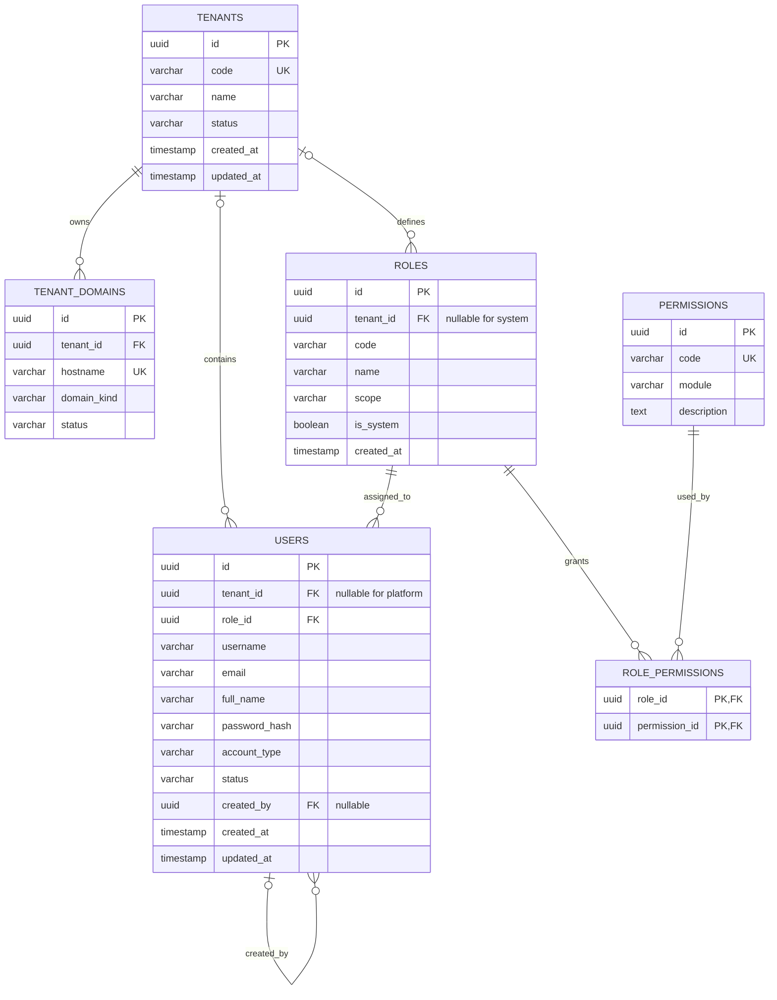
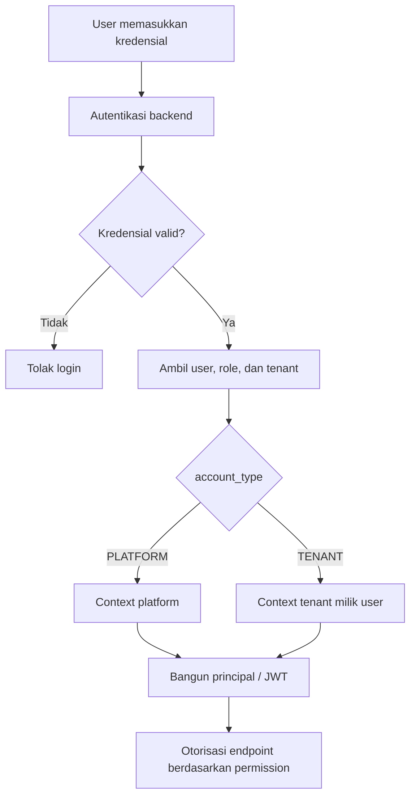
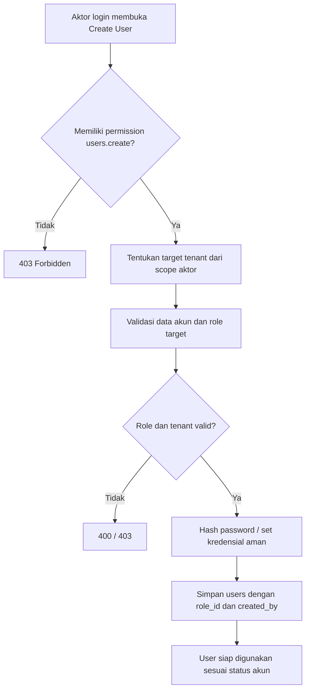
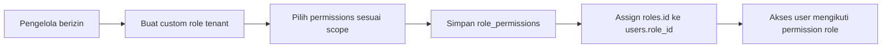

# Dagantara

> **Developer Documentation** · E-commerce multi-tenant platform · Living specification

Dokumentasi ini menjadi **sumber acuan pengembangan (source of truth)** Dagantara. Setiap modul ditambahkan setelah aturan bisnis, struktur data, dan batasan aksesnya selesai didiskusikan.

| Informasi | Detail |
| --- | --- |
| Produk | Dagantara |
| Arsitektur | Multi-tenant e-commerce |
| Fokus saat ini | User Management & RBAC |
| Status desain | **User Management: finalized** |
| Status implementasi | Belum dinyatakan selesai |
| Pembaruan dokumen | 18 November 2026 |

## 01 · Gambaran umum

Dagantara adalah fondasi e-commerce **multi-tenant**. Satu platform mengelola banyak tenant (bisnis/toko), tetapi setiap tenant hanya mengakses data yang berada dalam ruang lingkupnya sendiri.

Ada dua lapisan operasional utama:

- **Platform** — mengelola ekosistem tenant dan administrator tingkat platform.
- **Tenant** — mengelola pengguna dan operasional bisnis di dalam tenant masing-masing.

Satu akun pengguna mengikuti pendekatan **Simple User–Tenant**: satu user terhubung ke paling banyak satu tenant, dan memiliki **satu role aktif** pada tabel `users`. Akun platform tidak terikat tenant (`tenant_id = NULL`).

> [!IMPORTANT]
> Perancangan **User Management** telah selesai pada level konsep dan tabel. Bagian API, migrasi database, seed, serta implementasi backend/frontend masih memerlukan tahap engineering terpisah.

## 02 · Keputusan arsitektur yang final

| Area | Keputusan |
| --- | --- |
| Model identitas | **Simple User–Tenant** |
| Akun platform | `users.tenant_id` boleh `NULL` khusus akun platform |
| Akun tenant | `users.tenant_id` wajib berisi tenant pemilik akun |
| Relasi user–role | Setiap user memiliki **satu `role_id`** |
| Otorisasi | **Role-Based Access Control (RBAC)** murni |
| Permissions | Permission diberikan kepada **role**, bukan langsung ke user |
| Kebutuhan akses khusus | Buat role baru dengan kombinasi permission yang sesuai, lalu assign user |
| Pembuatan user | Langsung oleh user login yang memiliki permission membuat user |
| Ownership | Data tenant dibatasi menggunakan `tenant_id`, diverifikasi backend |
| Identitas saat login | Tenant diperoleh dari user terautentikasi, bukan dipilih bebas oleh client |
| System role | Role bawaan sistem memiliki `tenant_id = NULL` |
| Custom role tenant | Role yang dibuat tenant memiliki `tenant_id` tenant terkait |

### Hal yang sengaja tidak digunakan

Sesuai keputusan MVP, **tidak ada** tabel berikut:

- `user_invitations` — user dibuat langsung, tanpa invitation workflow.
- `user_audit_logs` — belum menjadi bagian skema User Management ini.
- `user_permission_denials` — tidak ada override atau penolakan permission per user.
- `user_permissions` — tidak ada grant permission langsung ke user.

Artinya, untuk membedakan akses dua pengguna, ubah **role yang di-assign**, bukan menyisipkan exception permission di level user.

## 03 · Tenant, scope, dan kepemilikan data

| Jenis akun | `account_type` | `tenant_id` | Role yang valid | Batas akses |
| --- | --- | --- | --- | --- |
| Admin / staf platform | `PLATFORM` | `NULL` | Role scope platform | Sesuai permission platform |
| Admin tenant | `TENANT` | ID tenant | Role scope tenant | Tenant miliknya |
| Staf tenant | `TENANT` | ID tenant | Role scope tenant | Tenant miliknya |

**Invarian keamanan:**

1. Client tidak boleh menentukan tenant yang akan diakses hanya melalui `tenant_id` dalam body, query string, atau header.
2. Backend mengambil identitas dan tenant user dari principal/JWT yang sudah terverifikasi, lalu menerapkan pemeriksaan pada query serta service.
3. Akun tenant tidak dapat membaca, mengubah, atau menghapus data tenant lain, meskipun menebak UUID atau mengganti parameter request.
4. Tenant tidak dapat membuat atau memberikan role dengan scope platform.
5. User hanya boleh meng-assign role yang valid untuk scope dan tenant target, serta tidak melewati batas kewenangan pembuatnya.
6. Tidak adanya permission berarti **ditolak** (*default deny*).

> [!NOTE]
> Detail hak lintas-tenant untuk operator platform ditentukan per permission dan endpoint. `PLATFORM` tidak berarti seluruh operasi otomatis boleh diakses tanpa otorisasi.

## 04 · Database — Entity Relationship Diagram

Skema final pada level tabel terdiri dari **6 tabel**: `tenants`, `tenant_domains`, `users`, `roles`, `permissions`, dan `role_permissions`.



**Keterangan:** relasi `TENANTS → USERS` dan `TENANTS → ROLES` bersifat opsional di sisi user/role karena akun platform dan role sistem dapat memiliki `tenant_id = NULL`.

## 05 · Kamus data (data dictionary)

Tipe SQL di bawah merupakan **rekomendasi implementasi PostgreSQL**, sedangkan **nama tabel dan kolom** mengikuti keputusan skema User Management. Aturan indeks, panjang string, enum/check constraint dan kebijakan delete masih dapat ditetapkan saat migrasi.

### 5.1 `tenants`

Mewakili organisasi, bisnis, atau toko yang menggunakan platform.

| Kolom | Tipe disarankan | Keterangan |
| --- | --- | --- |
| `id` | `UUID` | Primary key |
| `code` | `VARCHAR(60)` | Kode tenant, unik |
| `name` | `VARCHAR(160)` | Nama tenant |
| `status` | `VARCHAR(24)` | Status tenant |
| `created_at` | `TIMESTAMPTZ` | Waktu pembuatan |
| `updated_at` | `TIMESTAMPTZ` | Waktu perubahan |

### 5.2 `tenant_domains`

Menyimpan hostname/domain yang diarahkan ke satu tenant.

| Kolom | Tipe disarankan | Keterangan |
| --- | --- | --- |
| `id` | `UUID` | Primary key |
| `tenant_id` | `UUID` | Foreign key ke `tenants.id` |
| `hostname` | `VARCHAR(253)` | Hostname unik |
| `domain_kind` | `VARCHAR(24)` | Jenis domain/subdomain |
| `status` | `VARCHAR(24)` | Status domain |

> Nilai final untuk `domain_kind` dan `status` belum ditetapkan. Contoh nilai tidak dianggap kontrak database sampai disepakati.

### 5.3 `users`

Identitas login dan keanggotaan pengguna pada platform atau tenant.

| Kolom | Tipe disarankan | Keterangan |
| --- | --- | --- |
| `id` | `UUID` | Primary key |
| `tenant_id` | `UUID NULL` | FK `tenants.id`; `NULL` hanya untuk akun platform |
| `role_id` | `UUID` | FK `roles.id`; satu role per user |
| `username` | `VARCHAR(80)` | Nama login |
| `email` | `VARCHAR(254)` | Alamat email |
| `full_name` | `VARCHAR(160)` | Nama lengkap |
| `password_hash` | `VARCHAR(255)` | Password hash, tidak pernah password plaintext |
| `account_type` | `VARCHAR(16)` | `PLATFORM` atau `TENANT` |
| `status` | `VARCHAR(24)` | Status akun |
| `created_by` | `UUID NULL` | FK ke `users.id` pembuat akun |
| `created_at` | `TIMESTAMPTZ` | Waktu pembuatan |
| `updated_at` | `TIMESTAMPTZ` | Waktu perubahan |

**Constraint penting:** `account_type = 'PLATFORM'` mewajibkan `tenant_id IS NULL`; `account_type = 'TENANT'` mewajibkan `tenant_id IS NOT NULL`. Validitas `role_id` terhadap scope dan tenant harus dipastikan dalam service layer/transaksi (dan bila perlu trigger database).

### 5.4 `roles`

Kumpulan permission yang dapat di-assign kepada seorang user.

| Kolom | Tipe disarankan | Keterangan |
| --- | --- | --- |
| `id` | `UUID` | Primary key |
| `tenant_id` | `UUID NULL` | `NULL` untuk system role; terisi untuk custom role tenant |
| `code` | `VARCHAR(80)` | Kode role |
| `name` | `VARCHAR(120)` | Nama role |
| `scope` | `VARCHAR(16)` | `PLATFORM` atau `TENANT` |
| `is_system` | `BOOLEAN` | Menandakan role bawaan sistem |
| `created_at` | `TIMESTAMPTZ` | Waktu pembuatan |

**Batasan:** role tenant tidak boleh memuat permission level platform; perubahan `role_permissions` harus divalidasi sesuai scope aktor dan role target.

### 5.5 `permissions`

Katalog permission yang tersedia. Permission bukan milik user, melainkan direferensikan oleh role.

| Kolom | Tipe disarankan | Keterangan |
| --- | --- | --- |
| `id` | `UUID` | Primary key |
| `code` | `VARCHAR(120)` | Identifier permission unik |
| `module` | `VARCHAR(80)` | Kelompok modul |
| `description` | `TEXT` | Fungsi permission |

### 5.6 `role_permissions`

Tabel penghubung *many-to-many* dari role ke permission.

| Kolom | Tipe disarankan | Keterangan |
| --- | --- | --- |
| `role_id` | `UUID` | FK `roles.id`, composite PK |
| `permission_id` | `UUID` | FK `permissions.id`, composite PK |

Gunakan **primary key gabungan** `(role_id, permission_id)` supaya kombinasi tidak terduplikasi.

## 06 · Role-Based Access Control (RBAC)

### Cara permission dihitung

```text
Authenticated User
    └── users.role_id
          └── roles.id
                └── role_permissions
                      └── permissions.code
```

Contoh penamaan permission (masih dapat disesuaikan ketika kontrak API disusun):

| Permission | Kegunaan |
| --- | --- |
| `users.read` | Melihat daftar/detail pengguna dalam scope yang diizinkan |
| `users.create` | Membuat akun secara langsung |
| `users.update` | Mengubah data pengguna |
| `roles.read` | Melihat role dalam scope |
| `roles.create` | Membuat role baru |
| `roles.update` | Mengubah permission suatu role |
| `roles.assign` | Menetapkan role pada pengguna |

**Contoh role, bukan daftar role wajib:** `Platform Admin`, `Tenant Admin`, `Staff`, `Cashier`. Aplikasi tidak bergantung pada nama role saat memeriksa akses; gunakan **permission code**.

### Contoh kebutuhan akses khusus

Misalnya dua staf memiliki akses produk yang sama, tetapi hanya salah satunya boleh membuat user:

1. Buat role baru, misalnya `Staff + User Creator`.
2. Tambahkan permission pembuatan user pada role baru itu.
3. Assign `role_id` user terkait ke role baru.
4. Tidak perlu menambah kolom pengecualian permission pada `users`.

## 07 · Alur bisnis User Management

### 7.1 Login dan identifikasi tenant



### 7.2 Membuat pengguna (tanpa invitation)



Akun dibuat **langsung oleh user berizin**. Tidak ada proses kirim undangan, penerimaan invitation, maupun user permission override.

### 7.3 Membuat role baru dan assign user



## 08 · Kontrak implementasi — rancangan awal

Bagian ini adalah **rekomendasi teknis**, bukan endpoint yang telah difinalisasi atau diimplementasikan.

### Backend

- **Stack tujuan:** Spring Boot, PostgreSQL, JWT, JPA/Hibernate.
- Gunakan service otorisasi berbasis permission, contoh `hasAuthority('users.create')` setelah authorities diturunkan dari role.
- Validasi tenant dari principal di service/repository; jangan percaya tenant ID yang dikirim client.
- Simpan password menggunakan algoritme hash adaptif yang cocok untuk password (misalnya Argon2id/bcrypt), bukan enkripsi reversible.
- Transaksi pembuatan role dan relasi permissions harus atomik.
- Pertimbangkan invalidasi/refresh authority ketika permission role berubah agar token lama tidak terus membawa hak yang sudah dicabut.

### Kandidat endpoint API

```http
GET    /api/users
POST   /api/users
GET    /api/users/{id}
PATCH  /api/users/{id}
GET    /api/roles
POST   /api/roles
PATCH  /api/roles/{id}
PUT    /api/users/{id}/role
GET    /api/permissions
```

### Contoh body pembuatan user

```json
{
  "username": "staff.kasir",
  "email": "staff@example.test",
  "fullName": "Staff Kasir",
  "roleId": "00000000-0000-4000-8000-000000000001"
}
```

**Catatan keamanan:** `tenantId` tidak dipakai sebagai otoritas dari request user tenant. Mekanisme aktivasi akun dan pengaturan password awal belum difinalisasi.

## 09 · Checklist validasi & pengujian

- [ ] Akun platform hanya valid jika `tenant_id IS NULL`.
- [ ] Akun tenant hanya valid jika `tenant_id IS NOT NULL`.
- [ ] `users.role_id` mengarah ke role yang boleh dipakai sesuai account type/scope.
- [ ] User tenant A tidak dapat membaca user tenant B.
- [ ] User tenant A tidak dapat membuat user tenant B.
- [ ] Request tanpa permission pembuatan user mendapatkan `403`.
- [ ] Role tenant tidak bisa memberikan permission platform.
- [ ] Role baru dapat dibuat dan di-assign tanpa permission override per user.
- [ ] Duplikasi pasangan `role_id` + `permission_id` dicegah constraint database.
- [ ] Email/username uniqueness ditentukan eksplisit sebelum migration.
- [ ] Ketika role permission diubah, perilaku otorisasi mengikuti kebijakan refresh yang dipilih.
- [ ] Endpoint tidak mengandalkan `tenantId` dari client sebagai sumber kebenaran.

> Checklist ini adalah **acceptance criteria implementasi**, bukan klaim bahwa fiturnya telah selesai dikodekan.

## 10 · Status dokumen & pembahasan selanjutnya

| Modul | Status pembahasan | Catatan |
| --- | --- | --- |
| User Management | **Final — skema & aturan inti** | 6 tabel, Simple User–Tenant, RBAC |
| Authentication API | Belum difinalisasi | Login, refresh token, account activation |
| Tenant Management | Belum dibahas detail | Lifecycle, domain binding, subscription |
| Product / Catalog | Belum dibahas | Dirancang setelah prioritas ditentukan |
| Inventory | Belum dibahas | — |
| Order Management | Belum dibahas untuk Dagantara | — |
| Payment & Checkout | Belum dibahas | — |
| Reporting | Belum dibahas | — |

### Prinsip pemeliharaan dokumentasi

1. Tambahkan kesepakatan baru ke `README.md`, bukan menulis konten langsung di `index.html`.
2. Bedakan **Final** (keputusan), **Rancangan** (usulan), dan **Implemented** (sudah dibuat dan diverifikasi).
3. Update diagram Mermaid setiap kali relasi tabel berubah.
4. Jangan menganggap contoh endpoint, nilai enum, maupun tipe data rekomendasi sebagai keputusan final sebelum dikonfirmasi.
5. Jaga agar dokumentasi tidak mendahului cakupan implementasi.