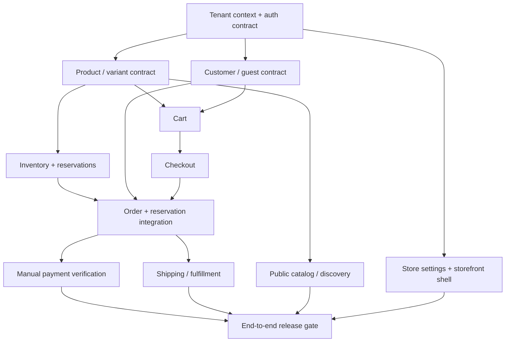

# Development Dependencies & Parallel Workstreams

> **Status: proposed execution plan.** This is an orchestration guide, not approval to implement unspecified features. Refer to each module specification for binding requirements. **P0** denotes MVP priority, not a strict sequential implementation order.

## Module Overview

Define dependency types, safe parallel development, interface contracts, and integration gates for Dagantara's multi-tenant commerce MVP.

## Dependency Semantics

- **Hard:** integration or correctness requires a stable upstream behavior/contract. Downstream implementation may start with mocks, but cannot pass integration gate until upstream is ready.
- **Soft:** improves the feature but can be deferred or replaced by an explicit MVP fallback.
- **Contract-first:** teams agree on tenant context, IDs, payloads, status transitions and ownership before editing independently.
- **Parallel:** implementation can proceed concurrently if file ownership, contracts, and database boundaries are separated.
- **Not a dependency:** documentation priority or menu ordering does not imply a technical prerequisite.

## Dependency Matrix (P0)

| Module | Hard dependencies for integration | Soft / optional dependencies | Parallel start conditions |
| --- | --- | --- | --- |
| Tenant Management | Platform identity/authorization contract | Domain verification automation | Define tenant ID, domain resolution and lifecycle first |
| User Management | Tenant identity and authorization boundaries for tenant users | Tenant Admin UI | Existing spec may advance against stable tenant contract |
| Product Management | Tenant isolation and product/variant identity contract | Categories/collections UI polish | Can advance alongside tenant setup using agreed tenant ID |
| Store Settings | Tenant identity | Storefront advanced theme editor | Contract for tenant settings and publication |
| Storefront Management (basic) | Tenant resolution, public settings contract | Advanced customization | Static UI and mock data can begin immediately |
| Inventory Management | Tenant, product/variant IDs | Warehouse/multi-location | Variant identity and reservation contract agreed |
| Product Catalog / Discovery | Tenant resolution, published product/variant read contract | Live inventory badge, advanced filtering | Mock public catalog contract; final gate requires real product data |
| Customer Management | Tenant context, customer identity/guest policy | Loyalty | Customer identity and guest-order decision |
| Address & Location | Tenant/customer ownership contract | External geocoding | Shipping address and origin schema agreed |
| Cart Management | Tenant, product/variant selection and pricing snapshot contract | Customer login | Cart item contract; guest cart decision |
| Checkout Management | Cart contract, order creation contract, payment/shipping selection contracts | Promotion engine | Shared checkout request/response and validation agreed |
| Order Management | Tenant, customer/guest identity, item/price snapshot, inventory reservation contract | Notification | State machine and idempotent order creation agreed |
| Payment Management | Order identity/amount/state contract | Gateway integrations | Manual transfer proof and verification contract agreed |
| Shipping Management | Order fulfillment/address contract | Courier API | Manual fee/fulfillment contract agreed |

**Important:** Catalog and Inventory are parallel workstreams, but product/variant identity must be stable. Payment and Shipping can be implemented in parallel after the Order contract is agreed, not after Order is fully coded. Checkout and Order may likewise be built in parallel contract-first.

## Dependency Diagram

Arrows show **integration prerequisites**, not a ban on parallel coding. A node may be built against mocks while its upstream dependency is unfinished.

## Parallel Development Plan

| Wave | Workstream / agent | Scope | Start gate | Integration gate |
| --- | --- | --- | --- | --- |
| 0 | Architecture / contracts | Tenant context, IDs, shared status model, API conventions, ownership | Existing decisions reviewed | Contract baseline accepted |
| 1 | A — Platform & identity | Tenant Management + User integration | Wave 0 | Tenant isolation and domain routing verified |
| 1 | B — Catalog data | Product Management + variant contract | Wave 0 | Published product/variant contract verified |
| 1 | C — Store experience | Store Settings + Storefront shell | Wave 0 | Correct tenant branding and route resolution |
| 1 | D — Customer | Customer identity, address model | Wave 0 | Customer/guest flow contract verified |
| 2 | E — Stock | Inventory, stock reservations | Variant contract | Reserve/release/commit semantics verified |
| 2 | F — Discovery | Public catalog, search/detail | Public product contract | Only correct tenant's published products visible |
| 2 | G — Cart | Cart and price snapshots | Variant + customer/guest contract | Valid cart items and tenant isolation |
| 2 | H — Transaction core | Order state machine + checkout contract | Order/checkout contract baseline | Idempotent order creation and reservation coordination |
| 3 | I — Payment | Manual transfer proof + admin verification | Order contract | Payment verification transitions safely |
| 3 | J — Fulfillment | Shipping rates, address, tracking | Order/address contract | Fulfillment state and shipping fees consistent |
| 4 | Integration | End-to-end storefront → order → payment → fulfillment | Waves 1–3 integration gates | Release acceptance scenarios pass |

**Parallelism:** Waves overlap where contracts permit. Wave 2 agents E/F/G/H need not wait for each other's implementation, only the agreed contracts. Wave 3 agents I/J can work in parallel against Order mocks.

## Contract Ownership & Conflict Avoidance

| Contract / shared resource | Primary owner | Consumers | Freeze before |
| --- | --- | --- | --- |
| Tenant ID, resolution, security context | Platform/Identity | All tenant modules | Parallel feature integration |
| Product/variant ID and publication | Catalog data | Inventory, Discovery, Cart, Order | Wave 2 |
| Stock reservation API and expiry | Inventory | Checkout, Order | Transaction integration |
| Customer/guest ID and address snapshot | Customer | Cart, Checkout, Order, Shipping | Wave 2 |
| Money, currency, pricing snapshot | Transaction core + Product | Cart, Checkout, Order, Payment | Wave 2 |
| Order ID, state transitions, idempotency | Order | Checkout, Payment, Shipping | Wave 3 |
| Manual payment proof and verification | Payment | Order, Tenant Admin | Wave 3 |
| Shipping fee and fulfillment contract | Shipping | Checkout, Order | Wave 3 |

Each agent owns its module files and tests. Shared DTOs, migrations, auth middleware and cross-module enums require a designated owner or a separately reviewed contract PR. Avoid simultaneous edits to the same files. Use isolated branches/worktrees and integrate small PRs into `dev` in dependency order; rebase or update from `dev` before merge.

## Integration Gates & Acceptance Scenarios

1. **IG-01 Tenant isolation:** Domain/tenant resolution is deterministic; no cross-tenant reads or writes, including public catalog and carts.
2. **IG-02 Catalog:** Only published and eligible products/variants are exposed to the correct storefront.
3. **IG-03 Inventory:** Concurrent order attempts do not oversell; reservations expire/release/commit according to an agreed lifecycle.
4. **IG-04 Cart and checkout:** Totals are validated server-side; price and address snapshots are persisted correctly.
5. **IG-05 Order:** Repeated checkout submission cannot create duplicate orders; state transitions are validated.
6. **IG-06 Payment:** Tenant admin verifies manual transfers only for own tenant; rejected/unpaid cases preserve correct order and stock states.
7. **IG-07 Shipping:** Fees and fulfillment state match the order; tenant isolation holds.
8. **IG-08 End-to-end:** Storefront catalog → cart → checkout → order → manual payment → fulfillment works on a tenant domain.

## Open Decisions / Blockers

| ID | Decision needed | Blocks |
| --- | --- | --- |
| DEP-01 | Tenant/domain lifecycle and inactive-tenant behavior | Tenant routing and public storefront gate |
| DEP-02 | Product publication and variant availability rules | Discovery/Cart integration |
| DEP-03 | Reservation duration, expiration and payment verification timing | Inventory/Order/Payment integration |
| DEP-04 | Guest checkout and customer identity policy | Customer/Cart/Checkout |
| DEP-05 | Shipping fee calculation, origin and delivery methods for MVP | Checkout/Shipping |
| DEP-06 | Order/payment/shipping state machine and cancellation rules | Order/Payment/Shipping |
| DEP-07 | Money, price snapshots, discount/tax treatment | Cart/Checkout/Order |

Do not infer decisions from this plan. Resolve blockers in their module specifications and link stable requirement IDs before implementation.

## Admin UI Structure

Workstream labels are engineering ownership only, **not** Admin menus or submenu requirements.

## Functional Specification

This plan coordinates implementation; it does not add business features beyond dedicated module specifications.

## Business Rules

Tenant isolation and server-side validation remain cross-cutting requirements. Hard dependencies are integration requirements; mocks are acceptable only during isolated development.

## Data Model

No new database tables or columns are authorized by this document. Data contracts are conceptual until module ERDs are finalized.
