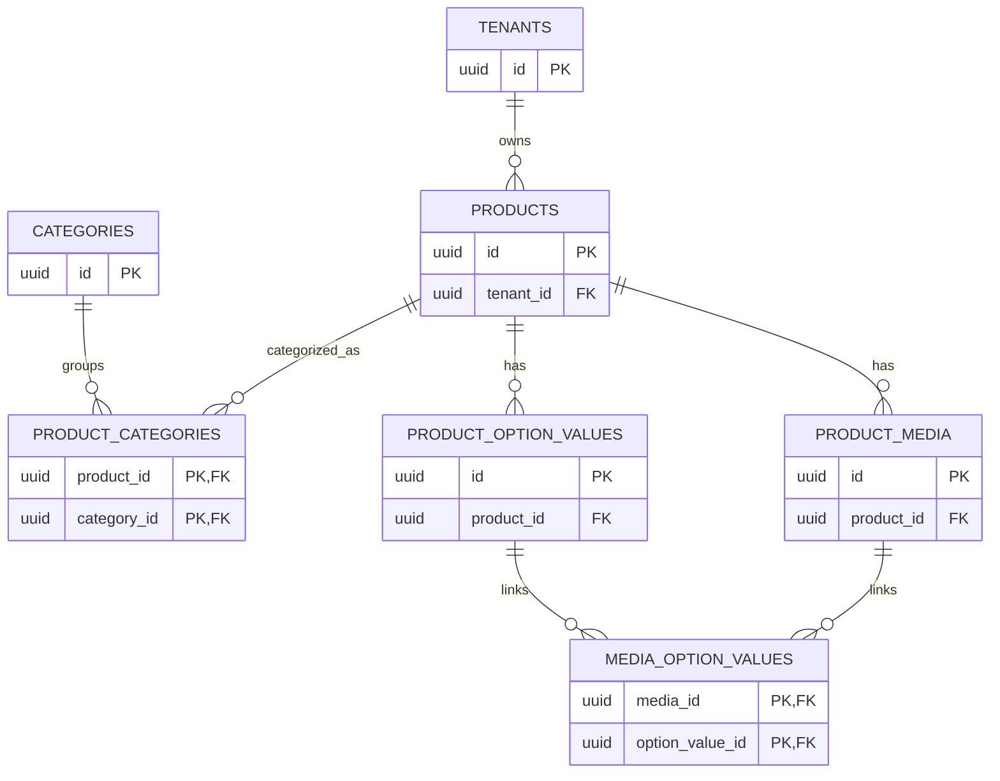

# Product Management

## Business Rules & Validation

- Setiap tenant mengelola katalog produknya sendiri (**Independent Catalog**).
- Satu produk dapat terhubung ke beberapa kategori dan memiliki satu **Primary Category**.
- Media dimiliki oleh produk.
- **Product Media** dan **Product Option Values** memiliki relasi many-to-many: satu media dapat terhubung ke beberapa nilai opsi dan satu nilai opsi dapat terhubung ke beberapa media.

## Tenant Admin — Menu & Features

| Area | Fitur dan aksi |
| --- | --- |
| Produk | Menentukan kategori produk dan Primary Category |
| Media Produk | Mengaitkan media produk dengan nilai opsi produk |

## Database — Entity Relationship Diagram

