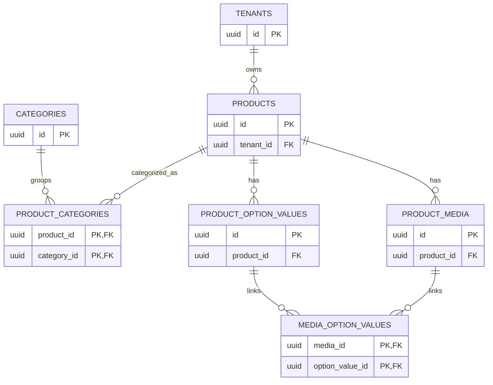

# Product Management

## Business Rules & Validation

- Setiap tenant mengelola katalog produknya sendiri (**Independent Catalog**).
- Satu produk dapat terhubung ke beberapa kategori dan memiliki satu **Primary Category**.
- Media dimiliki oleh produk.
- **Product Media** dan **Product Option Values** memiliki relasi many-to-many: satu media dapat terhubung ke beberapa nilai opsi dan satu nilai opsi dapat terhubung ke beberapa media.

## Tenant Admin — Menu & Features

Hierarki navigasi **Catalog** mengikuti referensi Tenant Admin:

```text
Tenant Admin
└── Catalog
    ├── Products
    ├── Categories
    ├── Brands
    ├── Collections
    └── Option Library
```

| Menu | Submenu / halaman | Fitur | Aksi |
| --- | --- | --- | --- |
| Catalog | Products | Kategori produk | Menghubungkan produk dengan beberapa kategori dan menentukan satu Primary Category |
| Catalog | Products | Media produk | Menghubungkan media produk dengan beberapa nilai opsi produk; satu nilai opsi dapat terhubung dengan beberapa media |

## Database — Entity Relationship Diagram



### Penjelasan tabel

| Tabel | Fungsi |
| --- | --- |
| `tenants` | Tenant pemilik katalog produk. |
| `products` | Data produk yang dimiliki tenant melalui `tenant_id`. |
| `categories` | Data kategori produk. |
| `product_categories` | Tabel penghubung produk dengan kategori. |
| `product_media` | Media yang dimiliki suatu produk. |
| `product_option_values` | Nilai opsi yang terkait dengan produk. |
| `media_option_values` | Tabel penghubung media produk dengan nilai opsi. |

### Penjelasan relasi

| Relasi | Makna |
| --- | --- |
| `tenants → products` | Setiap tenant memiliki katalog produknya sendiri. |
| `products ↔ categories` | Many-to-many melalui `product_categories`. Satu produk memiliki satu Primary Category dari kategori yang dipilih. |
| `products → product_media` | Satu produk dapat memiliki beberapa media. |
| `products → product_option_values` | Produk memiliki nilai opsi yang dapat dikaitkan dengan medianya. |
| `product_media ↔ product_option_values` | Many-to-many melalui `media_option_values`; media dapat ditautkan ke beberapa nilai opsi dan sebaliknya. |

**Catatan model:** aturan satu Primary Category telah disepakati; diagram yang ada belum menentukan lokasi kolom penandanya. Penambahan kolom/constraint menunggu keputusan skema, bukan ditetapkan oleh dokumentasi.
