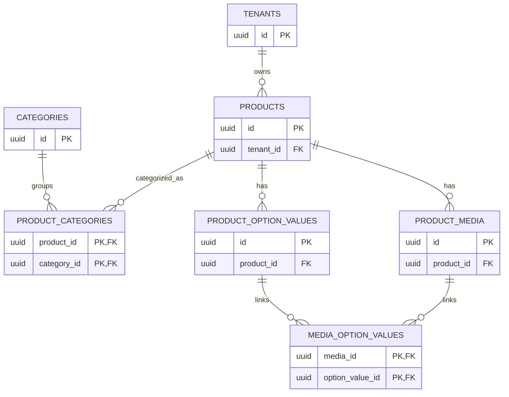

# Product Management

## Catalog

Setiap tenant memiliki katalog produk sendiri.

## Kategori Produk

Satu produk dapat masuk ke beberapa kategori, dengan tepat satu **Primary Category**.

## Media Produk

Media dimiliki oleh produk. Relasi antara **Product Media** dan **Product Option Values** bersifat many-to-many: satu media dapat terkait dengan beberapa nilai opsi, dan satu nilai opsi dapat terkait dengan beberapa media.

## Diagram Relasi

