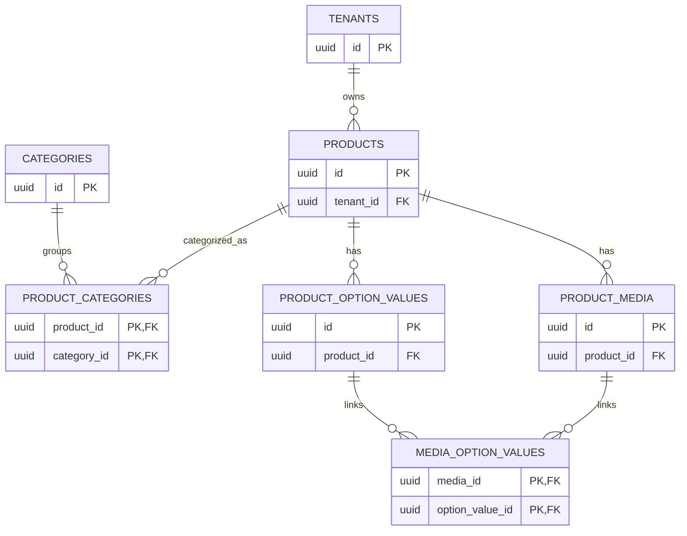

# Product Management

## Module Overview

Mengelola katalog produk per tenant (**Independent Catalog**), hubungan produk–kategori, dan asosiasi media produk dengan nilai opsi. Produk berada dalam katalog tenant pemiliknya.

## Admin UI Structure

Referensi struktur navigasi Tenant Admin:

```text
Tenant Admin
└── Catalog
    ├── Products
    ├── Categories
    ├── Brands
    ├── Collections
    └── Option Library
```

Nama submenu di atas mengikuti referensi navigasi. Spesifikasi fungsi yang sudah disepakati saat ini:

| Menu | Submenu / halaman | Fitur dan aksi | Requirement |
| --- | --- | --- | --- |
| Catalog | Products | Menghubungkan produk dengan beberapa kategori dan memilih satu Primary Category. | `PM-02` |
| Catalog | Products | Menghubungkan media produk ke nilai opsi produk. | `PM-03`, `PM-04` |

## Functional Specification

| ID | Perilaku |
| --- | --- |
| **PM-01** | Setiap tenant memiliki katalog produknya sendiri. Produk terhubung ke tenant pemilik. |
| **PM-02** | Produk dapat terhubung ke beberapa kategori dan memiliki tepat satu Primary Category. |
| **PM-03** | Media produk dimiliki oleh produk terkait. |
| **PM-04** | Satu media dapat dihubungkan dengan beberapa Product Option Values; satu Product Option Value dapat mempunyai beberapa media. |

## Business Rules

- **PM-BR-01:** katalog produk independen untuk setiap tenant.
- **PM-BR-02:** kategori produk bersifat many-to-many melalui `product_categories`; satu produk memiliki satu Primary Category.
- **PM-BR-03:** media merupakan bagian dari produk, bukan bagian dari pustaka nilai opsi.
- **PM-BR-04:** hubungan Product Media ↔ Product Option Values bersifat many-to-many melalui `media_option_values`.

## Data Model



### Penjelasan tabel

| Tabel | Fungsi |
| --- | --- |
| `tenants` | Tenant pemilik katalog produk. |
| `products` | Data produk yang dimiliki tenant melalui `tenant_id`. |
| `categories` | Data kategori produk. |
| `product_categories` | Tabel penghubung produk dengan kategori. |
| `product_media` | Media yang dimiliki suatu produk. |
| `product_option_values` | Nilai opsi yang terkait dengan produk. |
| `media_option_values` | Tabel penghubung media produk dengan nilai opsi. |

### Penjelasan relasi

| Relasi | Makna |
| --- | --- |
| `tenants → products` | Setiap tenant memiliki katalog produknya sendiri. |
| `products ↔ categories` | Many-to-many melalui `product_categories`. Satu produk memiliki satu Primary Category dari kategori yang dipilih. |
| `products → product_media` | Satu produk dapat memiliki beberapa media. |
| `products → product_option_values` | Produk memiliki nilai opsi yang dapat dikaitkan dengan medianya. |
| `product_media ↔ product_option_values` | Many-to-many melalui `media_option_values`; media dapat ditautkan ke beberapa nilai opsi dan sebaliknya. |

**Implementation dependency (`PM-02`).** Tentukan lokasi penyimpanan penanda Primary Category sebelum menetapkan kolom atau constraint untuk aturan tepat satu Primary Category.

**Implementation dependency (`PM-02`).** Tentukan cakupan kepemilikan kategori dan kategori mana yang boleh dipilih oleh setiap tenant. Keputusan ini diperlukan untuk menetapkan relasi kategori dan validasi penautan produk ke kategori.

## Acceptance Scenarios

| ID | Requirement | Kondisi | Tindakan | Hasil yang diharapkan |
| --- | --- | --- | --- | --- |
| **PM-AT-01** | `PM-01`, `PM-04` | Ada tenant A dan tenant B. Media dan nilai opsi yang valid tersedia pada produk yang diuji. Pelaku tenant B berwenang mengelola asosiasi media pada produknya sendiri. | Kaitkan produk ke katalog tenant A. Sebagai pelaku tenant B, coba tautkan media ke nilai opsi pada produk tersebut. | Produk tercatat sebagai milik tenant A. Penautan oleh pelaku tenant B ditolak dan asosiasi media produk tenant A tetap sama. |
| **PM-AT-02** | `PM-02` | Ada dua kategori yang valid untuk satu produk. | Kaitkan kedua kategori dengan produk dan pilih salah satunya sebagai Primary Category. | Kedua kategori terhubung dan hanya kategori yang dipilih berstatus Primary Category. |
| **PM-AT-03** | `PM-03`, `PM-04` | Satu produk memiliki media M1 dan nilai opsi V1 serta V2. Belum ada tautan dari M1 ke V1 maupun V2. | Tautkan M1 ke V1 dan V2. | M1 terhubung ke V1 dan V2. Pemilik M1 tetap produk semula. |
| **PM-AT-04** | `PM-03`, `PM-04` | Media M1 dan M2 serta nilai opsi V1 dimiliki produk yang sama. Belum ada tautan dari V1 ke M1 maupun M2. | Tautkan V1 ke M1 dan M2. | V1 terhubung ke M1 dan M2. Kedua media tetap dimiliki produk semula. |
