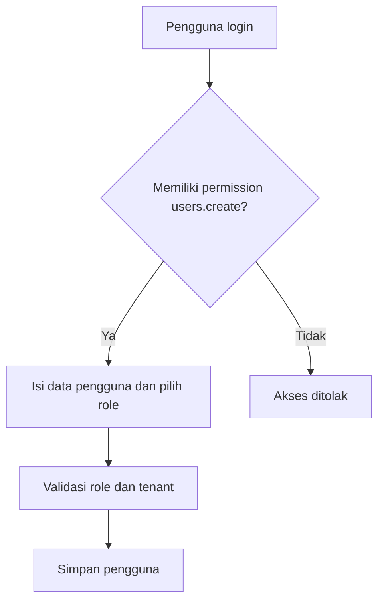
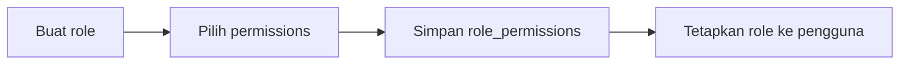
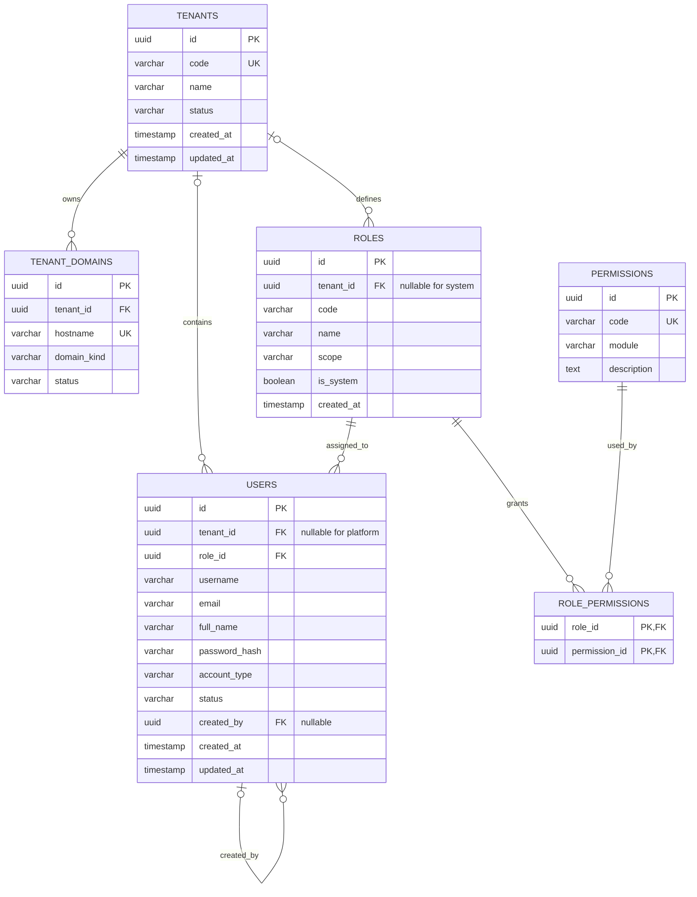

# User Management

## Module Overview

Mengelola akun pengguna, role, dan permission pada platform Dagantara serta dalam ruang tenant. Pengguna mempunyai satu role aktif; akses didasarkan pada permission yang melekat pada role tersebut.

## Admin UI Structure

Struktur navigasi yang dicatat untuk Tenant Admin:

```text
Tenant Admin
└── User Management
    ├── Users
    └── Roles
```

| Menu | Submenu / halaman | Fitur dan aksi | Requirement |
| --- | --- | --- | --- |
| User Management | Users | Membuat pengguna, melihat detail pengguna, dan menetapkan role pengguna. | `UM-01`, `UM-02`, `UM-04`, `UM-06` |
| User Management | Roles | Membuat role dan menentukan permission role. | `UM-04` |

## Functional Specification

| ID | Perilaku |
| --- | --- |
| **UM-01** | Pengguna terautentikasi dengan permission `users.create` dapat membuat akun pengguna. |
| **UM-02** | Pada pembuatan pengguna, sistem menentukan tenant sesuai konteks akun pembuat dan memvalidasi role yang diberikan. |
| **UM-03** | Setiap akun mempunyai satu role aktif yang disimpan melalui `users.role_id`. |
| **UM-04** | Pengguna tenant dengan `roles.create` dapat membuat role tenant. Pengguna tenant dengan `roles.permissions.update` dapat mengganti daftar permission role yang dapat dikelola. Pengguna tenant dengan `users.role.assign` dapat menetapkan role ke pengguna. Ketiga aksi berlaku dalam tenant pelaku. |
| **UM-05** | Otorisasi pengguna dihitung dari `users.role_id → roles → role_permissions → permissions`. |
| **UM-06** | Akses data pengguna tenant mengikuti batas tenant pemilik akun. Pengguna dengan `users.read` dapat membaca detail pengguna dalam tenant yang sama. Role dan tenant target harus valid. |
| **UM-07** | Sistem menyediakan role platform `SUPERADMIN` permanen. Operator menyiapkan akun platform pertama dengan role tersebut menggunakan kredensial yang disediakan saat penyiapan. |
| **UM-08** | Akun platform dengan `tenants.provision` dapat menyiapkan tenant baru beserta role sistem `TENANT_ADMIN` yang dimiliki tenant dan akun pengelola pertamanya dalam satu transaksi. |

| Permission | Aksi | Pemberian awal |
| --- | --- | --- |
| `users.create` | Membuat akun dalam scope pembuat | `SUPERADMIN`, `TENANT_ADMIN` |
| `users.read` | Membaca detail pengguna dalam tenant pelaku | `TENANT_ADMIN` |
| `roles.create` | Membuat role tenant tanpa permission awal | `TENANT_ADMIN` |
| `roles.permissions.update` | Mengganti daftar permission role tenant | `TENANT_ADMIN` |
| `users.role.assign` | Menetapkan role tenant pada pengguna | `TENANT_ADMIN` |
| `tenants.provision` | Membuat tenant, role sistem tenant, dan akun pengelola pertama | `SUPERADMIN` |

### Membuat Pengguna



### Mengelola Role



## Business Rules

- **UM-BR-01:** akun platform mempunyai `users.tenant_id = NULL`; akun tenant terhubung ke satu tenant.
- **UM-BR-02:** setiap pengguna mempunyai satu `role_id` aktif.
- **UM-BR-03:** permission diberikan kepada role melalui `role_permissions`, kemudian diperoleh pengguna melalui role-nya.
- **UM-BR-04:** pembuatan pengguna membutuhkan permission `users.create`.
- **UM-BR-05:** role yang ditetapkan harus sesuai dengan scope dan tenant pengguna. Data tenant hanya dapat diakses sesuai batas tenant yang diotorisasi.
- **UM-BR-06:** pasangan `(role_id, permission_id)` pada `role_permissions` bersifat unik.
- **UM-BR-07:** pelaku hanya boleh menambah permission yang dimilikinya dan termasuk permission tenant. Penggantian daftar permission role memerlukan akses atas seluruh permission role saat ini dan seluruh permission yang diminta. Penetapan role, termasuk saat membuat pengguna, memerlukan akses atas seluruh permission role yang akan diberikan. Penggantian role pengguna juga memerlukan akses atas permission role pengguna saat ini.
- **UM-BR-08:** `SUPERADMIN` adalah role sistem unik dengan scope `PLATFORM` dan `tenant_id = NULL`. Role ini tidak dapat dihapus atau diubah identitasnya dan ditetapkan kepada akun pertama saat penyiapan. Permission role tetap diperiksa melalui relasi `role_permissions`.
- **UM-BR-09:** kode role unik di dalam tenant. Kode `TENANT_ADMIN` dicadangkan untuk role sistem bawaan. Daftar permission role sistem tenant tidak dapat diubah melalui pengelolaan role.
- **UM-BR-10:** provisioning mengaktifkan tenant dan akun pengelola pertamanya. Akun tersebut memiliki tenant baru, role `TENANT_ADMIN` yang sesuai, dan referensi akun platform pembuat. Kegagalan pembuatan salah satu bagian membatalkan seluruh operasi.

## Data Model

Skema final pada level tabel terdiri dari **6 tabel**: `tenants`, `tenant_domains`, `users`, `roles`, `permissions`, dan `role_permissions`.



**Keterangan:** relasi `TENANTS → USERS` dan `TENANTS → ROLES` bersifat opsional di sisi user/role karena akun platform dan role sistem dapat memiliki `tenant_id = NULL`.

### Penjelasan tabel

| Tabel | Fungsi |
| --- | --- |
| `tenants` | Menyimpan tenant yang menggunakan Dagantara. |
| `tenant_domains` | Menyimpan hostname/domain yang terhubung dengan tenant. |
| `users` | Menyimpan akun pengguna, tenant pengguna, dan role aktif pengguna. |
| `roles` | Menyimpan role yang dapat ditetapkan kepada pengguna. |
| `permissions` | Menyimpan kode permission yang digunakan untuk otorisasi. |
| `role_permissions` | Menghubungkan role dengan permission yang dimilikinya. |

### Penjelasan relasi

| Relasi | Makna |
| --- | --- |
| `tenants → tenant_domains` | Satu tenant dapat memiliki beberapa domain. |
| `tenants → users` | Satu tenant dapat memiliki banyak pengguna. Akun platform tidak memiliki `tenant_id`. |
| `tenants → roles` | Tenant dapat memiliki role tenant; role sistem dapat memiliki `tenant_id = NULL`. |
| `roles → users` | Setiap pengguna memiliki satu role aktif melalui `users.role_id`. |
| `roles ↔ permissions` | Many-to-many melalui `role_permissions` dengan pasangan `(role_id, permission_id)` sebagai primary key. |
| `users → users` | `users.created_by` mereferensikan pengguna pembuat akun. |

## Acceptance Scenarios

| ID | Requirement | Kondisi | Tindakan | Hasil yang diharapkan |
| --- | --- | --- | --- | --- |
| **UM-AT-01** | `UM-01`, `UM-02`, `UM-03` | Pengelola tenant login dengan permission `users.create` dan memilih role yang valid untuk tenant tersebut. | Membuat akun pengguna. | Pengguna tersimpan pada tenant pelaku dan `role_id` menunjuk ke satu role yang dipilih. |
| **UM-AT-02** | `UM-01`, `UM-05` | Pengguna login tidak mempunyai permission `users.create`. Data calon pengguna dan role target valid. | Mencoba membuat pengguna. | Operasi ditolak dan calon pengguna tidak tersimpan. |
| **UM-AT-03** | `UM-04`, `UM-05` | Pengelola berizin mengelola role dalam tenant. Pengguna target berada di tenant yang sama dan belum memiliki `users.create`. | Pengelola membuat role, menghubungkan beberapa permission termasuk `users.create`, lalu menetapkan role itu ke pengguna target. Pengguna target login dan membuat akun dengan role yang valid. | Relasi permission tersimpan, `role_id` pengguna target menunjuk ke role baru, dan pembuatan akun berhasil melalui permission efektif dari role tersebut. |
| **UM-AT-04** | `UM-06` | Pengelola tenant A dapat menetapkan role di tenant A. Pengguna target berada di tenant B dan pengelola tidak berwenang di sana. | Mencoba menetapkan role yang valid untuk pengguna tenant B. Uji juga percobaan baca terhadap pengguna tersebut pada jalur baca yang sudah ditentukan. | Penetapan ditolak dan `role_id` pengguna tenant B tetap sama. Percobaan baca ditolak tanpa mengembalikan data pengguna target. |
| **UM-AT-05** | `UM-02`, `UM-04`, `UM-06` | Pengelola berwenang membuat pengguna dan menetapkan role dalam tenant. Role yang dipilih tidak sesuai scope atau tenant pengguna target. | Uji pemilihan role tersebut saat membuat pengguna baru dan saat mengubah role pengguna yang sudah ada. | Kedua tindakan ditolak. Akun baru tidak tersimpan dan `role_id` pengguna yang sudah ada tetap sama. |
| **UM-AT-06** | `UM-04`, `UM-07` | Role `SUPERADMIN` dan akun pertama sudah disiapkan. | Login dengan akun tersebut. Ulangi penyiapan akun, lalu coba hapus role saat tidak ada referensi pengguna. | Login berhasil. Penyiapan ulang tidak menggandakan akun. Penghapusan role ditolak dan role tetap tersedia. |
| **UM-AT-07** | `UM-01`, `UM-04`, `UM-08` | Akun platform memiliki `tenants.provision`. | Buat tenant dengan pengelola pertama. Login sebagai pengelola dan buat pengguna tenant. | Tenant, role `TENANT_ADMIN`, dan akun pengelola tersimpan dengan relasi yang sesuai. Pengelola memiliki permission bawaan dan dapat membuat pengguna di tenant baru. |
| **UM-AT-08** | `UM-04`, `UM-05`, `UM-06` | Pengelola memiliki akses pengelolaan role dengan sebagian permission tenant. | Beri permission di luar hak pengelola, tetapkan role yang melebihi haknya, atau baca detail pengguna tanpa `users.read`. | Operasi ditolak dan permission serta role pengguna tetap sama. Respons baca tidak mengembalikan data pengguna. |
