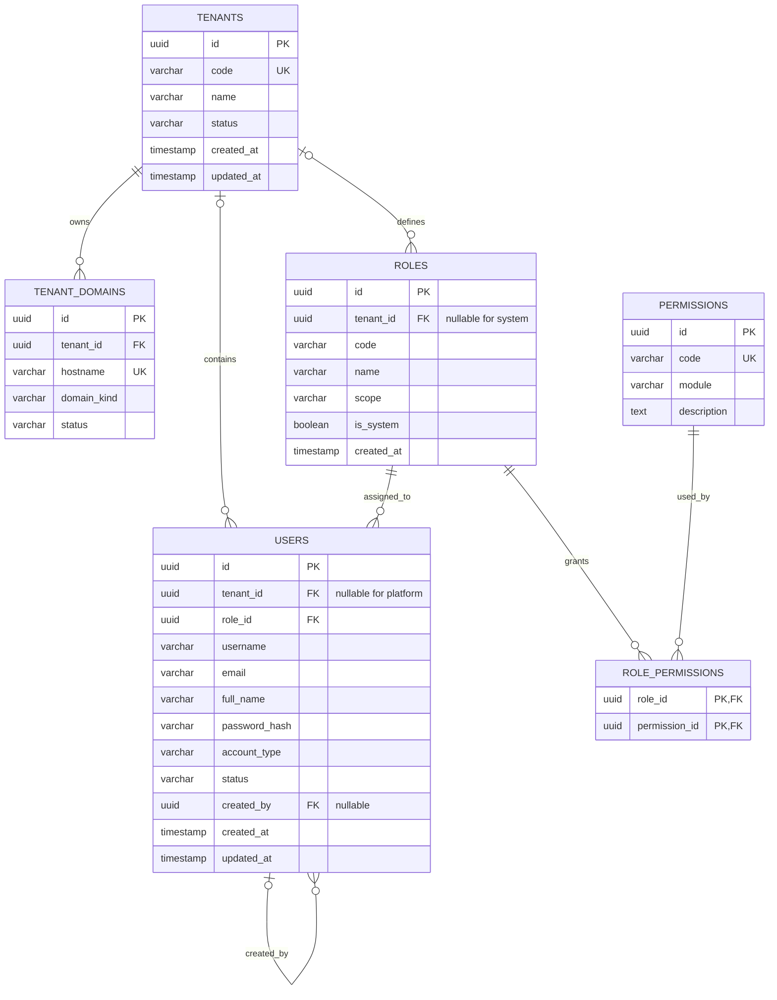
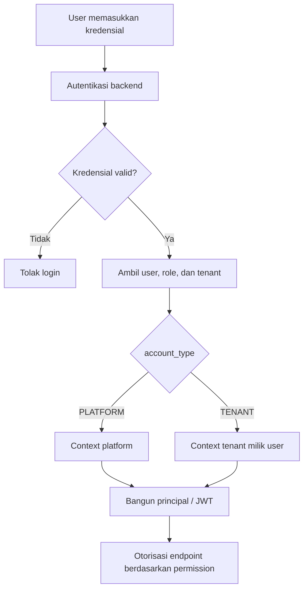
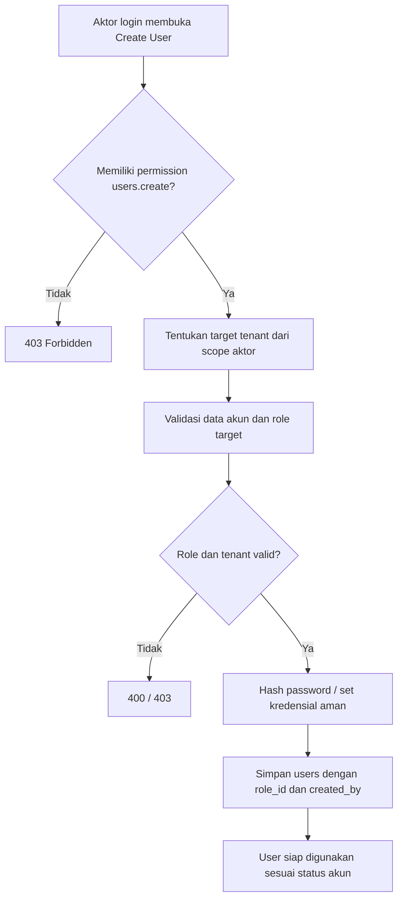
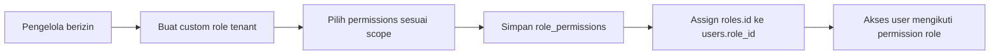

# User Management

## Database — Entity Relationship Diagram

Skema final pada level tabel terdiri dari **6 tabel**: `tenants`, `tenant_domains`, `users`, `roles`, `permissions`, dan `role_permissions`.



**Keterangan:** relasi `TENANTS → USERS` dan `TENANTS → ROLES` bersifat opsional di sisi user/role karena akun platform dan role sistem dapat memiliki `tenant_id = NULL`.

## Kamus data (data dictionary)

Tipe SQL di bawah merupakan **rekomendasi implementasi PostgreSQL**, sedangkan **nama tabel dan kolom** mengikuti keputusan skema User Management. Aturan indeks, panjang string, enum/check constraint dan kebijakan delete masih dapat ditetapkan saat migrasi.

### `tenants`

Mewakili organisasi, bisnis, atau toko yang menggunakan platform.

| Kolom | Tipe disarankan | Keterangan |
| --- | --- | --- |
| `id` | `UUID` | Primary key |
| `code` | `VARCHAR(60)` | Kode tenant, unik |
| `name` | `VARCHAR(160)` | Nama tenant |
| `status` | `VARCHAR(24)` | Status tenant |
| `created_at` | `TIMESTAMPTZ` | Waktu pembuatan |
| `updated_at` | `TIMESTAMPTZ` | Waktu perubahan |

### `tenant_domains`

Menyimpan hostname/domain yang diarahkan ke satu tenant.

| Kolom | Tipe disarankan | Keterangan |
| --- | --- | --- |
| `id` | `UUID` | Primary key |
| `tenant_id` | `UUID` | Foreign key ke `tenants.id` |
| `hostname` | `VARCHAR(253)` | Hostname unik |
| `domain_kind` | `VARCHAR(24)` | Jenis domain/subdomain |
| `status` | `VARCHAR(24)` | Status domain |

> Nilai final untuk `domain_kind` dan `status` belum ditetapkan. Contoh nilai tidak dianggap kontrak database sampai disepakati.

### `users`

Identitas login dan keanggotaan pengguna pada platform atau tenant.

| Kolom | Tipe disarankan | Keterangan |
| --- | --- | --- |
| `id` | `UUID` | Primary key |
| `tenant_id` | `UUID NULL` | FK `tenants.id`; `NULL` hanya untuk akun platform |
| `role_id` | `UUID` | FK `roles.id`; satu role per user |
| `username` | `VARCHAR(80)` | Nama login |
| `email` | `VARCHAR(254)` | Alamat email |
| `full_name` | `VARCHAR(160)` | Nama lengkap |
| `password_hash` | `VARCHAR(255)` | Password hash, tidak pernah password plaintext |
| `account_type` | `VARCHAR(16)` | `PLATFORM` atau `TENANT` |
| `status` | `VARCHAR(24)` | Status akun |
| `created_by` | `UUID NULL` | FK ke `users.id` pembuat akun |
| `created_at` | `TIMESTAMPTZ` | Waktu pembuatan |
| `updated_at` | `TIMESTAMPTZ` | Waktu perubahan |

**Constraint penting:** `account_type = 'PLATFORM'` mewajibkan `tenant_id IS NULL`; `account_type = 'TENANT'` mewajibkan `tenant_id IS NOT NULL`. Validitas `role_id` terhadap scope dan tenant harus dipastikan dalam service layer/transaksi (dan bila perlu trigger database).

### `roles`

Kumpulan permission yang dapat di-assign kepada seorang user.

| Kolom | Tipe disarankan | Keterangan |
| --- | --- | --- |
| `id` | `UUID` | Primary key |
| `tenant_id` | `UUID NULL` | `NULL` untuk system role; terisi untuk custom role tenant |
| `code` | `VARCHAR(80)` | Kode role |
| `name` | `VARCHAR(120)` | Nama role |
| `scope` | `VARCHAR(16)` | `PLATFORM` atau `TENANT` |
| `is_system` | `BOOLEAN` | Menandakan role bawaan sistem |
| `created_at` | `TIMESTAMPTZ` | Waktu pembuatan |

**Batasan:** role tenant tidak boleh memuat permission level platform; perubahan `role_permissions` harus divalidasi sesuai scope aktor dan role target.

### `permissions`

Katalog permission yang tersedia. Permission bukan milik user, melainkan direferensikan oleh role.

| Kolom | Tipe disarankan | Keterangan |
| --- | --- | --- |
| `id` | `UUID` | Primary key |
| `code` | `VARCHAR(120)` | Identifier permission unik |
| `module` | `VARCHAR(80)` | Kelompok modul |
| `description` | `TEXT` | Fungsi permission |

### `role_permissions`

Tabel penghubung *many-to-many* dari role ke permission.

| Kolom | Tipe disarankan | Keterangan |
| --- | --- | --- |
| `role_id` | `UUID` | FK `roles.id`, composite PK |
| `permission_id` | `UUID` | FK `permissions.id`, composite PK |

Gunakan **primary key gabungan** `(role_id, permission_id)` supaya kombinasi tidak terduplikasi.

## Role-Based Access Control (RBAC)

### Cara permission dihitung

```text
Authenticated User
    └── users.role_id
          └── roles.id
                └── role_permissions
                      └── permissions.code
```

Contoh penamaan permission (masih dapat disesuaikan ketika kontrak API disusun):

| Permission | Kegunaan |
| --- | --- |
| `users.read` | Melihat daftar/detail pengguna dalam scope yang diizinkan |
| `users.create` | Membuat akun secara langsung |
| `users.update` | Mengubah data pengguna |
| `roles.read` | Melihat role dalam scope |
| `roles.create` | Membuat role baru |
| `roles.update` | Mengubah permission suatu role |
| `roles.assign` | Menetapkan role pada pengguna |

**Contoh role, bukan daftar role wajib:** `Platform Admin`, `Tenant Admin`, `Staff`, `Cashier`. Aplikasi tidak bergantung pada nama role saat memeriksa akses; gunakan **permission code**.

### Contoh kebutuhan akses khusus

Misalnya dua staf memiliki akses produk yang sama, tetapi hanya salah satunya boleh membuat user:

1. Buat role baru, misalnya `Staff + User Creator`.
2. Tambahkan permission pembuatan user pada role baru itu.
3. Assign `role_id` user terkait ke role baru.
4. Tidak perlu menambah kolom pengecualian permission pada `users`.

## Alur bisnis User Management

### Login dan identifikasi tenant



### Membuat pengguna (tanpa invitation)



Akun dibuat **langsung oleh user berizin**. Tidak ada proses kirim undangan, penerimaan invitation, maupun user permission override.

### Membuat role baru dan assign user



## Kontrak implementasi — rancangan awal

Bagian ini adalah **rekomendasi teknis**, bukan endpoint yang telah difinalisasi atau diimplementasikan.

### Backend

- **Stack tujuan:** Spring Boot, PostgreSQL, JWT, JPA/Hibernate.
- Gunakan service otorisasi berbasis permission, contoh `hasAuthority('users.create')` setelah authorities diturunkan dari role.
- Validasi tenant dari principal di service/repository; jangan percaya tenant ID yang dikirim client.
- Simpan password menggunakan algoritme hash adaptif yang cocok untuk password (misalnya Argon2id/bcrypt), bukan enkripsi reversible.
- Transaksi pembuatan role dan relasi permissions harus atomik.
- Pertimbangkan invalidasi/refresh authority ketika permission role berubah agar token lama tidak terus membawa hak yang sudah dicabut.

### Kandidat endpoint API

```http
GET    /api/users
POST   /api/users
GET    /api/users/{id}
PATCH  /api/users/{id}
GET    /api/roles
POST   /api/roles
PATCH  /api/roles/{id}
PUT    /api/users/{id}/role
GET    /api/permissions
```

### Contoh body pembuatan user

```json
{
  "username": "staff.kasir",
  "email": "staff@example.test",
  "fullName": "Staff Kasir",
  "roleId": "00000000-0000-4000-8000-000000000001"
}
```

**Catatan keamanan:** `tenantId` tidak dipakai sebagai otoritas dari request user tenant. Mekanisme aktivasi akun dan pengaturan password awal belum difinalisasi.
