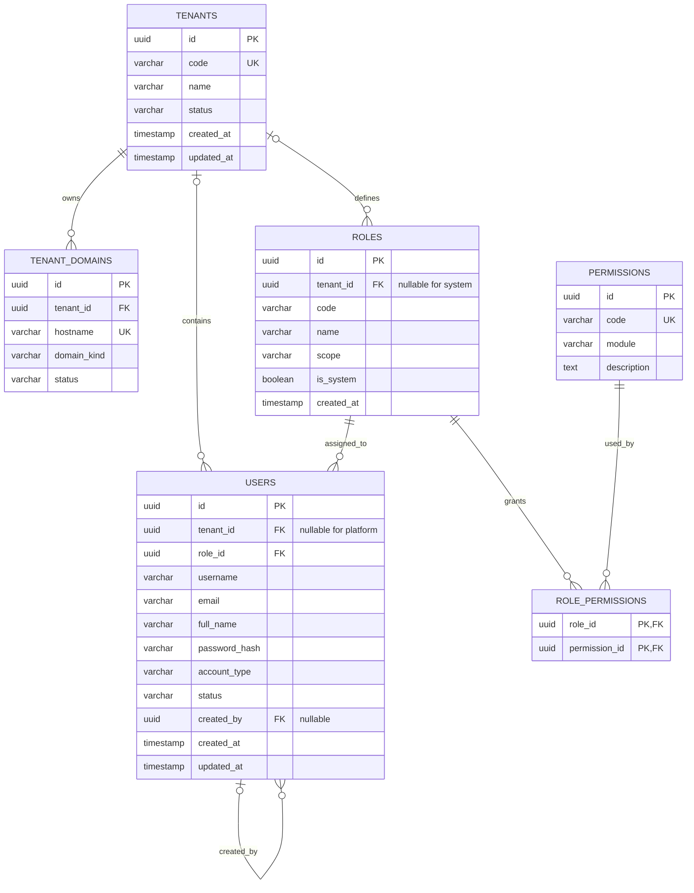
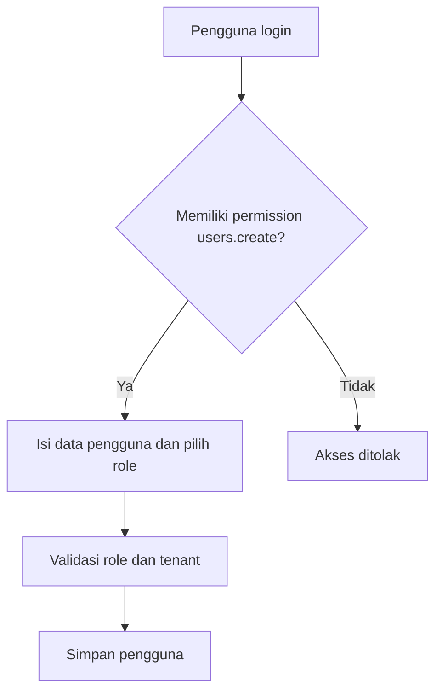
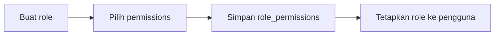

# User Management

## Database — Entity Relationship Diagram

Skema final pada level tabel terdiri dari **6 tabel**: `tenants`, `tenant_domains`, `users`, `roles`, `permissions`, dan `role_permissions`.

**Keterangan:** relasi `TENANTS → USERS` dan `TENANTS → ROLES` bersifat opsional di sisi user/role karena akun platform dan role sistem dapat memiliki `tenant_id = NULL`.

## Business Rules & Validation

- Pengguna platform memiliki `users.tenant_id = NULL`; pengguna tenant terhubung ke satu tenant.
- Setiap pengguna memiliki satu `users.role_id`.
- Permission diturunkan dari role melalui `role_permissions`. Akses khusus diatur dengan membuat role dan menetapkannya kepada pengguna yang sesuai.
- Pengguna yang sedang login dan memiliki permission `users.create` dapat membuat pengguna secara langsung.
- Role harus sesuai dengan scope dan tenant pengguna. Data tenant diakses dalam cakupan tenant terkait.
- Setiap pasangan `(role_id, permission_id)` pada `role_permissions` bersifat unik.

## Tenant Admin — Menu & Features

| Area | Fitur dan aksi |
| --- | --- |
| Pengguna | Membuat pengguna; menetapkan role pengguna |
| Role | Membuat role; menetapkan permission pada role |

## Permissions

Permission diberikan melalui role. Permission `users.create` diperlukan untuk membuat pengguna.

## Workflow

### Membuat Pengguna

### Mengelola Role

